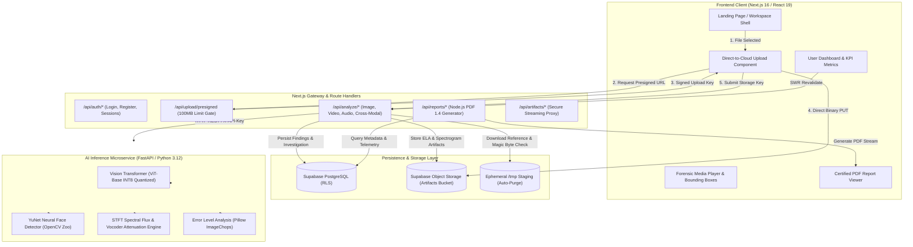

# TruthLens: Multimodal Digital Forensics and Deepfake Detection System

[](https://nextjs.org/)
[](https://react.dev/)
[](https://www.python.org/)
[](https://fastapi.tiangolo.com/)
[](https://onnxruntime.ai/)
[](https://opencv.org/)
[](https://supabase.com/)
[](https://tailwindcss.com/)
[](LICENSE)

> **"See Beyond the Surface. Verify What Is Real."**  
> An explainable, evidence-linked digital forensic platform for authenticating synthetic media, deepfakes, and manipulated audio-visual records through tri-modal cross-verification and forensic triangulation.

---

## Table of Contents

- [1. Project Overview](#1-project-overview)
- [2. Problem Statement](#2-problem-statement)
- [3. Our Proposed Solution](#3-our-proposed-solution)
  - [Tri-Modal Cross-Verification (Video ↔ Audio ↔ Text)](#tri-modal-cross-verification-video--audio--text)
  - [Forensic Triangulation (Deep Learning + Classical Signal Forensics)](#forensic-triangulation-deep-learning--classical-signal-forensics)
  - [Uncertainty-Aware Forensic Reporting](#uncertainty-aware-forensic-reporting)
- [4. Key Features](#4-key-features)
- [5. Technology Stack](#5-technology-stack)
- [6. System Architecture](#6-system-architecture)
- [7. Detection Methodology](#7-detection-methodology)
  - [Image Forensics Pipeline](#image-forensics-pipeline)
  - [Video Forensics Pipeline](#video-forensics-pipeline)
  - [Audio Forensics Pipeline](#audio-forensics-pipeline)
  - [Text & Speech Verification](#text--speech-verification)
  - [Cross-Modal Correlation Engine](#cross-modal-correlation-engine)
- [8. Project Workflow](#8-project-workflow)
- [9. Installation and Setup](#9-installation-and-setup)
  - [Prerequisites](#prerequisites)
  - [Step 1: Clone Repository & Install Next.js Frontend](#step-1-clone-repository--install-nextjs-frontend)
  - [Step 2: Setup Python AI Inference Microservice](#step-2-setup-python-ai-inference-microservice)
  - [Step 3: Setup Pretrained ONNX Models](#step-3-setup-pretrained-onnx-models)
  - [Step 4: Configure Environment Variables](#step-4-configure-environment-variables)
  - [Step 5: Database Setup (PostgreSQL / Supabase)](#step-5-database-setup-postgresql--supabase)
  - [Step 6: Run Locally](#step-6-run-locally)
- [10. Environment Variables](#10-environment-variables)
- [11. API Documentation](#11-api-documentation)
  - [Next.js Route Handlers](#nextjs-route-handlers)
  - [Python FastAPI Microservice Endpoints](#python-fastapi-microservice-endpoints)
- [12. Project Directory Structure](#12-project-directory-structure)
- [13. Interface & Capabilities](#13-interface--capabilities)
- [14. Research Gap and Novelty](#14-research-gap-and-novelty)
- [15. Limitations and Future Enhancements](#15-limitations-and-future-enhancements)
- [16. Team Information](#16-team-information)
- [17. References](#17-references)
- [18. License and Contributions](#18-license-and-contributions)

---

## 1. Project Overview

**TruthLens** is an open-source, multi-tenant digital forensic platform engineered to detect generative deepfakes, synthetic voice clones, manipulated portraits, and multimodal desynchronization in digital media. 

In an era of hyper-realistic generative artificial intelligence (diffusion models, neural vocoders, facial reenactment, and voice cloning), determining digital authenticity has become a critical challenge for legal examiners, journalists, intelligence analysts, and digital platforms. TruthLens bridges the gap between opaque academic neural networks and practical forensic workflows by providing:

1. **Deterministic Chain of Custody**: Immediate SHA-256 cryptographic hashing upon media ingestion.
2. **Transparent Signal Decomposition**: Disentangling neural classifier inferences from deterministic signal-processing heuristics (Error Level Analysis, spectral flux, Nyquist frequency boundaries, and inter-frame motion variance).
3. **Traceable Evidence Attribution**: Linking every flagged anomaly directly to specific keyframes, bounding box regions `[x, y, w, h]`, and millisecond timestamps.
4. **Courtroom-Ready Reporting**: Generating certified PDF 1.4 forensic documentation that includes executive assessments, evidence relationships, and explicit technical limitations.

---

## 2. Problem Statement

Modern generative deepfake pipelines (FaceSwap, DeepFaceLab, LivePortrait, ElevenLabs, VALL-E, Sora, Midjourney) have rendered single-modality detectors obsolete:

- **Unimodal Blindness**: Conventional forensic tools evaluate images, audio, video, or text in isolation. An adversary can generate a manipulated video stream with untouched genuine audio, or splice synthetic speech into an authentic broadcast without visual distortion. Unimodal systems fail to detect cross-stream inconsistencies.
- **Opaque Black-Box Verdicts**: Many commercial detectors produce ungrounded probability scores (e.g., *"98.4% Fake"*) without localizing the artifact, explaining the underlying signal anomaly, or disclosing error margins. Such scores are inadmissible in legal proceedings and unhelpful for investigative corroboration.
- **False Positives from Lossy Compression**: Telephony codecs, social media re-compression (H.264/H.265 compression, WhatsApp/YouTube transcoding), and camera noise are frequently misclassified as synthetic artifacts by naive neural models.
- **Payload & Latency Bottlenecks**: Serverless edge environments struggle with multimegabyte video payloads (e.g., Vercel's 4.5 MB request limit), leading to timeouts, truncated uploads, and uncoordinated rate limits.

---

## 3. Our Proposed Solution

TruthLens addresses these fundamental challenges through a hybrid architecture combining deep learning models, classical signal processing heuristics, and multi-tenant persistence.

```
                          ┌───────────────────────────────┐
                          │    Uploaded Digital Media     │
                          │   (Video / Audio / Image)     │
                          └──────────────┬────────────────┘
                                         │ SHA-256 Custody Hash
                                         ▼
                     ┌───────────────────────────────────────┐
                     │     Direct-to-Cloud Ingestion Gate    │
                     │  (Magic Byte Check, 100MB Presigned)  │
                     └───────────────────┬───────────────────┘
                                         │
        ┌────────────────────────────────┼────────────────────────────────┐
        ▼                                ▼                                ▼
┌─────────────────┐            ┌───────────────────┐            ┌─────────────────┐
│ Visual Pipeline │            │ Acoustic Pipeline │            │ Text / Context  │
│  • ViT Patch DL │            │  • STFT Spectrum  │            │  • Speech ASR   │
│  • YuNet Faces  │            │  • Vocoder Cutoff │            │  • Lexical Sync │
│  • ELA Mapping  │            │  • Web Audio DSP  │            │  • Context Diff │
│  • Frame Jitter │            │  • Saturation     │            │  • Named Entity │
└───────┬─────────┘            └─────────┬─────────┘            └────────┬────────┘
        │                                │                               │
        └────────────────────────────────┼───────────────────────────────┘
                                         ▼
                     ┌───────────────────────────────────────┐
                     │   Tri-Modal Cross-Verification Graph  │
                     │     (±1.5s Temporal Window Co-oc)     │
                     └───────────────────┬───────────────────┘
                                         ▼
                     ┌───────────────────────────────────────┐
                     │   Uncertainty-Aware Forensic Engine   │
                     │  • Verified Signals vs. Heuristics    │
                     │  • Calibrated Confidence Scoring      │
                     │  • Certified PDF 1.4 Audit Report     │
                     └───────────────────────────────────────┘
```

### Tri-Modal Cross-Verification (Video ↔ Audio ↔ Text)
Instead of treating streams independently, TruthLens cross-correlates visual facial motion (visemes) against speech acoustic timing (phonemes) and sworn textual affidavits. Anomalies co-occurring within a calibrated $\pm 1.5$-second temporal window (e.g., a speech burst with frozen lips, or an acoustic splice during continuous facial motion) are automatically identified and mapped into a relational evidence topology.

### Forensic Triangulation (Deep Learning + Classical Signal Forensics)
TruthLens combines deep neural representation learning with verifiable classical physics:
- **Neural Layer**: Quantized Vision Transformer (`google/vit-base-patch16-224-in21k` fine-tuned on deepfake datasets) and YuNet neural face detection.
- **Physical Signal Layer**: JPEG Error Level Analysis (ELA) to expose differential quantization anomalies, Laplacian edge variance for focal discontinuity, Short-Time Fourier Transform (STFT) for vocoder high-frequency loss above 6 kHz, and EXIF software signature provenance inspection.

### Uncertainty-Aware Forensic Reporting
In digital forensics, claiming absolute certainty without definitive proof is unscientific. TruthLens explicitly categorizes all findings into:
- `isHeuristic: true`: Deterministic signal tests (compression flags, clipping, metadata).
- `isHeuristic: false`: Neural model inferences with probabilistic confidence scores.
- Four-tier calibrated verdicts:
  1. **No Significant Indicators Detected** (standard baseline).
  2. **Requires Further Review** (inconclusive metrics or low resolution).
  3. **Potentially Manipulated** (neural anomalies or co-occurring temporal markers).
  4. **High Probability of Tampering** (corroborated cross-modal discrepancies).

---

## 4. Key Features

| Capability | Description | Status |
| :--- | :--- | :---: |
| **Image Deepfake Detection** | ViT-based patch tampering evaluation, YuNet facial localization with bounding boxes, and EXIF software signature inspection. | **Implemented** |
| **Error Level Analysis (ELA)** | Differential JPEG re-compression mapping (90% quality delta) with scaled brightness enhancement to reveal manipulated image regions. | **Implemented** |
| **Video Deepfake Detection** | Automated FFmpeg frame demuxing, uniform temporal sampling, frame-by-frame ViT inference, and face tracking. | **Implemented** |
| **Interactive Video Player** | Custom forensic media player with millisecond timestamp seeking, keyframe scrubber, and enlarged face bounding box modal. | **Implemented** |
| **Audio Forensics & DSP** | STFT spectral flux computation, high-frequency vocoder cutoff detection (>6 kHz), digital clipping detection, and room-tone dropout analysis. | **Implemented** |
| **Web Audio In-Browser DSP** | Real-time client-side audio decoding, RMS/peak dBFS calculation, noise floor profiling, and stereo-to-mono downmixing. | **Implemented** |
| **Cross-Modal Correlation** | Relational graph linking video keyframes, acoustic waveforms, and text transcripts across temporal tolerance windows ($\pm 1.5$s). | **Implemented** |
| **Direct-to-Cloud Uploads** | Presigned URL upload pipeline supporting up to 100 MB media files, bypassing serverless request size limits. | **Implemented** |
| **Magic Byte Binary Defense** | Deep binary header validation preventing executable injection (ELF, PE, Shell scripts) masquerading as media extensions. | **Implemented** |
| **Certified PDF 1.4 Export** | Standalone Node.js PDF report generation with forensic headers, metadata tables, findings list, and examiner signature lines. | **Implemented** |
| **User Dashboard & Metrics** | Comprehensive KPI overview (6 metric cards, modality distribution progress bar, full-width recent activity feed, report archives). | **Implemented** |
| **Multi-Tenant Persistence** | PostgreSQL persistence with Row Level Security (RLS) on Supabase, supporting registered analysts and isolated guest sandboxes. | **Implemented** |
| **Guest-to-Account Transfer** | Atomic ownership migration of all guest investigations and telemetry when an anonymous user logs in or registers. | **Implemented** |
| **Strict Monochrome UI** | Clean, professional black-and-white visual identity (#FFFFFF, #000000, #111111, #E5E5E5) designed for forensic laboratory clarity. | **Implemented** |

---

## 5. Technology Stack

| Category | Technology | Purpose in TruthLens |
| :--- | :--- | :--- |
| **Frontend Framework** | **Next.js 16.4.6** (App Router, Turbopack) | Server-rendered pages, API route handlers, React server components. |
| **UI Library** | **React 19** | Declarative user interface, custom hooks, reactive state management. |
| **Styling & Design** | **Tailwind CSS v4**, **PostCSS 8.5** | Modern utility-first styling, CSS custom properties, responsive breakpoints. |
| **Icons & Typography** | **Lucide React 1.16** | Consistent forensic iconography (shields, waveforms, search glyphs). |
| **3D Visualizer** | **Three.js 0.187**, **@react-three/fiber**, **@react-three/drei** | Interactive 3D robotic model rendered in the landing page hero section. |
| **Data Fetching** | **SWR 2.5** | Stale-while-revalidate client-side caching for investigation histories. |
| **Backend Runtimes** | **Node.js 20+**, **Python 3.10+ / 3.12** | Core API gateway, microservice orchestration, and AI execution. |
| **AI Inference Service** | **FastAPI 0.115**, **Uvicorn 0.30** | Standalone high-concurrency microservice for neural inference. |
| **Deep Learning Engine** | **ONNX Runtime 1.18+** (`onnxruntime`) | High-speed INT8 quantized inference across CPU/GPU execution providers. |
| **Pretrained Models** | **ViT (Vision Transformer)**, **YuNet Face Detector** | `google/vit-base-patch16-224-in21k` (87.3 MB) + OpenCV YuNet (232 KB). |
| **Computer Vision** | **OpenCV 4.10** (`opencv-python-headless`) | FaceDetectorYN, frame extraction, color space conversions, image decoding. |
| **Image Processing** | **Pillow 10.4** (PIL) | Error Level Analysis (ELA), ImageChops difference scaling, format conversions. |
| **Media Processing** | **FFmpeg Static 5.3** (`ffmpeg-static`) | In-process demuxing, video stream frame sampling, and audio track isolation. |
| **Audio Processing** | **Web Audio API**, **NumPy 1.26** (STFT) | Client-side acoustic decoding, FFT frequency binning, spectral flux calculation. |
| **Production Database** | **Supabase PostgreSQL** | Relational persistence, Row Level Security (RLS), multi-tenant schemas. |
| **Cloud Object Storage** | **Supabase Storage** | Binary artifact retention (spectrograms, ELA maps, generated PDF reports). |
| **Security & Auth** | **scrypt PBKDF2**, **HTTP-Only Cookies** | Cryptographic analyst authentication, 30-day session TTLs, timing-safe checks. |
| **Containerization** | **Docker**, **Docker Compose** | Production deployment of the Python AI microservice. |
| **Deployment Targets** | **Railway**, **Vercel** | AI microservice hosting on Railway; Next.js frontend and edge API on Vercel. |

---

## 6. System Architecture

TruthLens employs a modern decoupled architecture where the Next.js edge gateway coordinates client interactions and media routing, while heavy neural tensor processing is delegated to a dedicated Python FastAPI service or local fallback CLI.



---

## 7. Detection Methodology

### Image Forensics Pipeline
1. **Metadata & Software Provenance**: Scans binary headers for signatures from image-generation engines (`Midjourney`, `Stable Diffusion`, `DALL-E`, `ComfyUI`) and editing software (`Adobe Photoshop`, `GIMP`, `Lightroom`, `Canva`).
2. **Error Level Analysis (ELA)**: Re-saves the image at a known 90% JPEG compression factor, computes pixel-level absolute difference maps with Pillow, and enhances brightness scales up to $15\times$. Splices and digital insertions display prominent error spikes due to differing compression histories.
3. **YuNet Neural Face Detection**: Locates all facial regions, outputting bounding boxes `[x, y, w, h]` and landmark points at a 0.60 confidence threshold.
4. **ViT Patch Classification**: Crops detected faces with 15% contextual padding, resizes to $224 \times 224$, normalizes to mean 0.5 / std 0.5, and evaluates patch-level feature representations with INT8 quantized Vision Transformers.

### Video Forensics Pipeline
1. **Uniform Keyframe Extraction**: Invokes FFmpeg to sample keyframes at configurable frequencies (default: 1.0 fps, up to 60 frames), preventing UI lockup while ensuring temporal coverage.
2. **Per-Frame Face & Deepfake Scoring**: Runs YuNet facial detection and ViT patch classification on each sampled frame.
3. **Inter-Frame Temporal Variance**: Measures pixel differences and facial contour consistency across adjacent frames to identify face-swapping boundary warping, temporal jitter, or sudden cuts.
4. **Suspicious Timestamp Generation**: Flags every frame exceeding manipulation thresholds with exact millisecond timecodes (`mm:ss.ms`), frame numbers, and severity ratings (`critical`, `high`, `moderate`).

### Audio Forensics Pipeline
1. **Header Parsing & Ingestion**: Validates RIFF/WAVE, MP3, or M4A containers, confirming sample rate (e.g., 44.1 kHz, 48 kHz) and channel configurations.
2. **In-Browser Web Audio Processing**: Computes RMS amplitude, peak amplitude in decibels full-scale (dBFS), signal-to-noise ratio (SNR), dynamic range, and digital clipping samples near 0 dBFS.
3. **STFT Spectral Flux & Frequency Attenuation**: Slices audio with Hanning windows (1024 FFT size, 512 hop size), computing spectral flux across adjacent frames.
4. **Vocoder Cutoff Detection**: Evaluates energy concentration across upper frequency bins ($>6\text{ kHz}$). Severe high-frequency roll-offs ($<1.5\%$ energy) are flagged as indicative of neural vocoders or low-bitrate acoustic synthesis.

### Text & Speech Verification
1. **ASR Speech Transcription**: Extracts spoken dialogue segments with start/end timestamps.
2. **Contextual Affidavit Comparison**: Ingests examiner-provided context, sworn statements, or reference transcripts.
3. **Lexical & Semantic Discrepancy**: Detects transcript omissions, substituted dialogue, named entity contradictions, or fabricated phrases that contradict sworn contextual statements.

### Cross-Modal Correlation Engine
1. **Temporal Alignment Window**: Cross-references visual and acoustic events occurring within a $\pm 1.5$-second tolerance window.
2. **Phoneme-Viseme Lip-Sync Correlation**: Identifies occurrences where speech acoustic energy is present while facial landmarks indicate closed or static lips, or where facial articulation occurs in total acoustic silence.
3. **Relational Topology Construction**: Synthesizes findings into an interactive node-link graph mapping relationships between video files, audio tracks, keyframes, and transcript assertions.

---

## 8. Project Workflow

```
[ Step 1: Open TruthLens Workspace ]
        │
        ▼
[ Step 2: Select Forensic Modality ] ───► (Image / Video / Audio / Cross-Modal)
        │
        ▼
[ Step 3: Media Ingestion & SHA-256 Hashing ]
        │  • Cryptographic Chain-of-Custody hash computed immediately
        │  • Direct-to-cloud presigned upload for files up to 100 MB
        ▼
[ Step 4: Security & Validation Gate ]
        │  • Magic byte binary verification (blocks executable/script injection)
        │  • Extension & MIME whitelist checks
        ▼
[ Step 5: Dual Forensic Analysis Execution ]
        │  ├─► Classical Forensics (ELA, Laplacian variance, STFT, metadata)
        │  └─► Neural Inference (ViT Transformer, YuNet face detector)
        ▼
[ Step 6: Tri-Modal Cross-Verification ]
        │  • Correlates video keyframes, audio acoustics, and context transcripts
        │  • Flags temporal discrepancies within ±1.5s tolerance windows
        ▼
[ Step 7: Interactive Evidence Review ]
        │  • Scrutinize suspicious regions & bounding boxes
        │  • Scrub video player to exact anomaly millisecond timestamps
        │  • Review plain-English explanations and recommended examiner actions
        ▼
[ Step 8: Certified PDF Report Export ]
        │  • Generate courtroom-ready PDF 1.4 document with audit trail
        ▼
[ Step 9: History & Dashboard Persistence ]
           • Investigation saved to Supabase PostgreSQL under user account
```

---

## 9. Installation and Setup

### Prerequisites

Ensure the following tools are installed on your host system:
- **Node.js**: `v20.x` or `v22.x` ([nodejs.org](https://nodejs.org/))
- **pnpm**: `v9.x` or `v10.x` (`npm install -g pnpm`)
- **Python**: `3.10`, `3.11`, or `3.12` ([python.org](https://www.python.org/))
- **FFmpeg**: System FFmpeg or bundled static binaries ([ffmpeg.org](https://ffmpeg.org/))
- **Git**: ([git-scm.com](https://git-scm.com/))

---

### Step 1: Clone Repository & Install Next.js Frontend

```bash
# Clone the repository
git clone https://github.com/Sapthahack-20206/TruthLens.git
cd TruthLens

# Install Node.js dependencies using pnpm
pnpm install
```

---

### Step 2: Setup Python AI Inference Microservice

The AI microservice can be run as a standalone FastAPI service:

```bash
# Navigate to the microservice directory
cd ai-service

# Create and activate a Python virtual environment
python -m venv venv

# On Linux/macOS:
source venv/bin/activate
# On Windows (PowerShell):
.\venv\Scripts\Activate.ps1

# Install required Python dependencies
pip install -r requirements.txt

# Return to project root
cd ..
```

---

### Step 3: Setup Pretrained ONNX Models

TruthLens uses two neural models located in the `models/` directory:

1. **`models/deepfake_vit_quantized.onnx`** (~87.3 MB):
   - Architecture: Vision Transformer (`google/vit-base-patch16-224-in21k` fine-tuned on deepfake classification).
   - Source: [HuggingFace - prithivMLmods/Deepfake-Detection-Exp-02-21-ONNX](https://huggingface.co/prithivMLmods/Deepfake-Detection-Exp-02-21-ONNX).
2. **`models/face_detection_yunet_2023mar.onnx`** (~232 KB):
   - Architecture: YuNet Face Detector.
   - Source: [OpenCV Zoo](https://github.com/opencv/opencv_zoo).

Ensure both model binaries are present in the `models/` folder:
```bash
ls -lh models/
# Expected:
# deepfake_vit_quantized.onnx       (~87 MB)
# face_detection_yunet_2023mar.onnx  (~232 KB)
```

---

### Step 4: Configure Environment Variables

Create your local environment configuration by copying `.env.example`:

```bash
# Copy template to .env.local
cp .env.example .env.local
```

Edit `.env.local` to configure your database and service endpoints (see [Section 10](#10-environment-variables) for detailed descriptions).

---

### Step 5: Database Setup (PostgreSQL / Supabase)

TruthLens includes zero-config local persistence fallback for offline development. To enable full multi-tenant persistence:

1. Create a project at [supabase.com](https://supabase.com).
2. Open the **SQL Editor** in the Supabase Dashboard.
3. Paste and execute the contents of [`database/schema.sql`](./database/schema.sql).
4. Create a public storage bucket named `truthlens-forensic-artifacts`.
5. Add your `SUPABASE_URL` and `SUPABASE_SERVICE_ROLE_KEY` to `.env.local`.

---

### Step 6: Run Locally

#### Option A: Running with Local Python Service

In Terminal 1 (Start Python AI Service):
```bash
cd ai-service
uvicorn app.main:app --host 0.0.0.0 --port 8000 --reload
```

In Terminal 2 (Start Next.js Frontend):
```bash
# In the project root:
pnpm run dev
```

Open [http://localhost:3000](http://localhost:3000) in your browser.

#### Option B: Production Build

```bash
# Build the optimized production bundle with Turbopack
pnpm run build

# Start the production Next.js server
pnpm run start
```

---

## 10. Environment Variables

The table below documents all configuration variables supported by TruthLens:

| Variable | Required | Default | Description |
| :--- | :---: | :---: | :--- |
| `NODE_ENV` | Optional | `development` | Node runtime environment (`development` or `production`). |
| `PORT` | Optional | `3000` | HTTP port for the Next.js server. |
| `NEXT_PUBLIC_API_BASE_URL` | Optional | `""` | Base URL for client API calls (leave empty for same-origin). |
| `ALLOWED_ORIGIN` | Optional | `https://truthlens.ai` | Whitelisted origin for CORS validation on edge proxies. |
| `FFMPEG_PATH` | Optional | `Bundled static` | Path to custom system FFmpeg binary (e.g. `/usr/bin/ffmpeg`). |
| `FFPROBE_PATH` | Optional | `Bundled static` | Path to custom system FFprobe binary. |
| `PYTHON_PATH` | Optional | `python` | Path to Python interpreter executable. |
| `RATE_LIMIT_ANALYZE_MAX` | Optional | `10` | Maximum analysis requests allowed per IP per 60-second window. |
| `RATE_LIMIT_READ_MAX` | Optional | `60` | Maximum read requests allowed per IP per 60-second window. |
| `NEXT_PUBLIC_SUPABASE_URL` | Optional | `""` | Supabase project URL (client-exposed). |
| `SUPABASE_URL` | Optional | `""` | Supabase project URL for server-side route handlers. |
| `SUPABASE_SERVICE_ROLE_KEY` | Optional | `""` | Supabase secret service role key for administrative operations. |
| `SUPABASE_ANON_KEY` | Optional | `""` | Supabase public anonymous API key. |
| `SUPABASE_STORAGE_BUCKET` | Optional | `truthlens-forensic-artifacts` | Storage bucket name for forensic image and PDF artifacts. |
| `AI_SERVICE_URL` | Optional | `""` | URL of the remote Python AI microservice (e.g. on Railway). |
| `PYTHON_INFERENCE_URL` | Optional | `""` | Alternate alias for `AI_SERVICE_URL`. |
| `AI_SERVICE_API_KEY` | Optional | `""` | Shared secret token passed in `X-API-Key` to the AI microservice. |

---

## 11. API Documentation

### Next.js Route Handlers

#### 1. Forensic Analysis Gateways
- **`POST /api/analyze`**: Unified multimodal ingestion endpoint.
  - *Payload*: `multipart/form-data` with `files: File[]`, `prompt: string`.
  - *Response*: `ForensicAnalysisOutput` JSON object containing indicators, summary, and custody hash.
- **`POST /api/analyze/image`**: Dedicated image forensics.
  - *Payload*: `multipart/form-data` with `file: Binary` or JSON `{ storageKey, filename }`.
  - *Response*: Image indicators, ELA compression map URL, and face bounding box regions.
- **`POST /api/analyze/video`**: Video deepfake and temporal frame analysis.
  - *Payload*: `multipart/form-data` with `file: Binary` or JSON `{ storageKey, filename }`.
  - *Response*: Frame-by-frame scores, anomalous frame count, and suspicious timestamp list.
- **`POST /api/analyze/audio`**: Acoustic spectral and voice clone analysis.
  - *Payload*: `multipart/form-data` with `file: Binary` or JSON `{ storageKey, filename }`.
  - *Response*: Synthetic voice probability, STFT spectral flux, and clipping indicators.
- **`POST /api/analyze/cross-modal`**: Tri-modal evidence correlation.
  - *Payload*: JSON bundle `{ videoFindings, audioFindings, transcriptFindings, context }`.
  - *Response*: Correlation findings, phoneme-viseme alignment, and relational graph edges.

#### 2. Media Upload & Streaming
- **`POST /api/upload/presigned`**: Requests a signed direct-to-cloud upload URL.
  - *Payload*: `{ filename: string, mimeType: string, fileSize: number }`.
  - *Response*: `{ uploadUrl: string, storageKey: string, provider: string }`.
- **`POST /api/upload/direct`**: Chunked direct serverless binary upload fallback.
- **`GET /api/artifacts/[filename]`**: Securely streams generated forensic artifacts (ELA images, spectrograms).
- **`GET /forensic-output/[filename]`**: Public artifact streaming endpoint.

#### 3. Reports & Investigations
- **`GET /api/investigations`**: Retrieves paginated investigation records for the active session.
- **`GET /api/investigations/[id]`**: Fetches complete telemetry and findings for an investigation ID.
- **`GET /api/reports/[id]`**: Generates and streams certified forensic reports (`Accept: application/pdf` returns binary PDF 1.4; `Accept: application/json` returns report audit metadata).

#### 4. Authentication & Health
- **`POST /api/auth/register`**: Registers a forensic analyst account (`{ name, email, password }`).
- **`POST /api/auth/login`**: Authenticates an analyst and sets an HTTP-only session cookie.
- **`POST /api/auth/logout`**: Terminates the session and revokes the active token.
- **`GET /api/auth/me`**: Returns the current authenticated analyst profile or guest sandbox status.
- **`GET /api/health`**: Comprehensive health check verifying database, storage, and AI availability.

---

### Python FastAPI Microservice Endpoints

All endpoints support authentication via `X-API-Key: <token>` or `Authorization: Bearer <token>`.

- **`GET /health`**: Liveness probe returning `{ status: "ok", service: "truthlens-ai-inference" }`.
- **`GET /api/v1/models`**: Inventory of loaded ONNX models, architectures, and input dimensions.
- **`GET /api/v1/models/availability`**: Readiness probe checking whether ViT and YuNet models are operational.
- **`POST /api/v1/analyze/image`**: Executes ViT and YuNet inference on an uploaded image.
- **`POST /api/v1/analyze/video`**: Uniformly extracts keyframes and evaluates temporal manipulation.
- **`POST /api/v1/analyze/audio`**: Evaluates audio frequency spectrum and vocoder attenuation.

Interactive OpenAPI documentation is accessible at `http://localhost:8000/docs`.

---

## 12. Project Directory Structure

```
TruthLens/
├── ai-service/                     # Python FastAPI AI Inference Microservice
│   ├── app/
│   │   ├── config.py               # Paths, model locations, environment settings
│   │   ├── detector.py             # ViT inference, YuNet face detection, STFT DSP
│   │   ├── main.py                 # FastAPI application, route declarations, CORS
│   │   ├── schemas.py              # Pydantic request and response data contracts
│   │   └── security.py            # API key validation and authentication checks
│   ├── tests/
│   │   └── test_service.py         # Microservice unit and integration test suite
│   ├── Dockerfile                  # Container definition for Python 3.12 microservice
│   ├── docker-compose.yml          # Compose specification for multi-service testing
│   └── requirements.txt            # Python dependencies (fastapi, onnxruntime, opencv)
├── app/                            # Next.js 16 App Router
│   ├── api/                        # Serverless edge and Node.js route handlers
│   │   ├── analyze/                # Forensic analysis dispatchers (image, video, audio)
│   │   ├── artifacts/              # Artifact streaming proxy
│   │   ├── auth/                   # Analyst registration, login, logout, profile
│   │   ├── health/                 # Diagnostics and readiness probe
│   │   ├── investigations/         # Investigation history endpoints
│   │   ├── reports/                # Certified PDF report generation
│   │   └── upload/                 # Direct and presigned cloud upload gates
│   ├── forensic-output/            # Direct artifact streaming route
│   ├── workspace/                  # Forensic workspace client application
│   ├── [slug]/                     # Dynamic policy and authentication pages
│   ├── globals.css                 # Centralized monochrome design system tokens
│   ├── layout.tsx                  # Root HTML shell and font definitions
│   └── page.tsx                    # Landing page entry point
├── components/                     # Modular React 19 UI components
│   ├── analysis-history.tsx        # Searchable and filterable investigation history
│   ├── analysis-result.tsx         # Executive verdict and telemetry presenter
│   ├── auth-screen.tsx             # Analyst authentication and guest migration UI
│   ├── evidence-graph.tsx          # Interactive cross-modal topology visualizer
│   ├── explainable-evidence-viewer.tsx # Detailed indicators and plain-English breakdown
│   ├── forensic-media-player.tsx   # Video player with keyframe seeking & zoom modal
│   ├── media-upload.tsx            # Drag-and-drop file upload with SHA-256 pre-hash
│   ├── multimodal-correlation-panel.tsx # Tri-modal correlation & lip-sync panel
│   ├── truthlens-landing.tsx       # Public homepage and platform principles
│   ├── truthlens-robot.tsx         # Three.js 3D interactive robot visualizer
│   ├── user-dashboard.tsx          # KPI cards, full-width activities, modality launchpad
│   └── workspace-shell.tsx         # Main application navigation and state shell
├── database/                       # Database DDL schema & migrations
│   ├── schema.sql                  # PostgreSQL / Supabase multi-tenant DDL script
│   └── README.md                   # Relational architecture and setup documentation
├── docs/                           # Architecture and security documentation
│   └── SECURITY_AND_INFRASTRUCTURE.md # Security, CORS, and cloud upload specifications
├── lib/                            # Shared utilities and core forensic engines
│   ├── analysis/                   # Forensic analyzers, PDF generator, and types
│   │   ├── report-generator.ts     # Pure Node.js standard PDF 1.4 document builder
│   │   ├── image-analyzer.ts       # ELA mapping, metadata inspection, ViT caller
│   │   ├── video-analyzer.ts       # FFmpeg keyframe extraction, temporal variance
│   │   └── audio-analyzer.ts       # Digital clipping, RMS, and vocoder analysis
│   ├── backend-engine/             # Production services and cloud adapters
│   │   ├── auth-service.ts         # scrypt password hashing, session tokens
│   │   ├── cloud-storage.ts        # Supabase Storage client & presigned URLs
│   │   ├── database.ts             # Supabase PostgreSQL client & query helpers
│   │   ├── model-service.ts        # HTTP client for FastAPI / local Python fallback
│   │   └── rate-limiter.ts         # Sliding-window rate limiters
│   ├── audio-forensics.ts          # Web Audio API in-browser DSP and spectral analysis
│   ├── demo-samples.ts             # Benchmark demonstration media bundles
│   ├── evidence-utils.ts           # Severity helpers, time formatters, hash utils
│   ├── multimodal-correlation-engine.ts # Tri-modal temporal window correlation
│   └── truthlens-api.ts            # Client-side API fetching and SWR integrations
├── models/                         # Pretrained ONNX model directory
│   ├── README.md                   # Model provenance and download references
│   ├── deepfake_vit_quantized.onnx # Vision Transformer classifier (87.3 MB)
│   └── face_detection_yunet_2023mar.onnx # YuNet Face Detector (232 KB)
├── public/                         # Static assets and benchmark media
│   ├── models/                     # 3D GLB model assets
│   ├── samples/                    # Evidentiary video, audio, and transcript samples
│   └── videos/                     # Sample synthetic media files for testing
├── .env.example                    # Production environment configuration template
├── package.json                    # Node.js dependencies and script definitions
├── railway.json                    # Deployment specification for Railway hosting
└── tsconfig.json                   # TypeScript compiler configuration
```

---

## 13. Interface & Capabilities

TruthLens provides a streamlined forensic interface adhering to an approved strict monochrome palette:

- **Public Landing Page**: Features an interactive Three.js 3D robotic model, evidentiary principles, platform overview, forensic science methodology, and direct media upload.
- **Forensic Workspace Dashboard**: Displays 6 operational KPI metric cards, a Modality Analysis Distribution progress bar, a full-width Recent Analysis Activities feed, and a balanced secondary grid for Forensic Reports and Modality Launchpads.
- **Deepfake Evidence Viewer**: Breaks down each forensic indicator into plain English, showing severity badges, technical support levels, confidence scores, and recommended examiner actions.
- **Forensic Video Player**: Enables millisecond-level keyframe scrubbing, visualizes suspicious sections along a playback timeline, and allows frame zoom inspection with localized facial bounding boxes.
- **Certified PDF Reports**: Courtroom-ready forensic examination documents formatted with examiner signature lines, SHA-256 chain-of-custody hashes, metadata provenance tables, and methodology limitations.

---

## 14. Research Gap and Novelty

| Dimension | Conventional Detection Platforms | TruthLens Forensic System |
| :--- | :--- | :--- |
| **Analysis Modality** | Unimodal (only image, or only audio, or only video). | **Tri-Modal Cross-Verification** (Video ↔ Audio ↔ Text graph topology). |
| **Forensic Triangulation** | Purely statistical deep learning (susceptible to adversarial bypass). | **Hybrid Triangulation**: Deep neural embeddings (ViT + YuNet) combined with physical signal processing (ELA, STFT, Laplacian variance). |
| **Evidence Explainability** | Opaque percentage score (*"99% Fake"*). | **Traceable Localization**: Exact face bounding boxes `[x, y, w, h]`, frame numbers, and millisecond timestamps. |
| **Handling of Uncertainty** | Forced binary classification (Real vs. Fake). | **Uncertainty-Aware Reporting**: Four calibrated verdict tiers with explicit methodological limitations disclosed. |
| **Legal Admissibility** | Unverified outputs without chain of custody. | **Tamper-Evident Chain of Custody**: Cryptographic SHA-256 hashing upon ingestion and certified PDF 1.4 audit export. |

---

## 15. Limitations and Future Enhancements

### Existing System Limitations
- **Resolution Dependencies**: Vision Transformer patch embeddings require face crops of at least $20 \times 20$ pixels; heavily downsampled or distant faces yield inconclusive confidence.
- **Codec Compression Interference**: Low-bitrate telephony compression (e.g., AMR, G.711) or aggressive video transcoding naturally attenuates high frequencies, requiring human examiner review.
- **Compute Sizing**: Video temporal analysis is capped at 60 sampled keyframes by default to ensure sub-second response times without specialized GPU acceleration.

### Planned Enhancements
- [ ] Integration of spatial-temporal 3D CNNs (e.g., VideoMAE / R(2+1)D) for continuous facial micro-expression tracking.
- [ ] GPU-accelerated TensorRT execution provider for real-time 60 fps live-stream forensic monitoring.
- [ ] Support for C2PA (Coalition for Content Provenance and Authenticity) cryptographic manifest verification.
- [ ] Expanded multilingual automatic speech recognition (ASR) with phoneme-level forced alignment.

---

## 16. Team Information

TruthLens is researched, engineered, and maintained by **Team CARPEDIEM**:

| Role | Details |
| :--- | :--- |
| **Project Team** | **CARPEDIEM** |
| **Domain** | Multimodal Digital Forensics & AI Trust / Safety |
| **Repository** | [https://github.com/Sapthahack-20206/TruthLens](https://github.com/Sapthahack-20206/TruthLens) |
| **Contact** | `hello@truthlens.ai` |

---

## 17. References

1. **Vision Transformers for Media Tampering**: Dosovitskiy, A., et al. *"An Image is Worth 16x16 Words: Transformers for Image Recognition at Scale."* ICLR 2021.
2. **Deepfake Benchmark Forensics**: Rössler, A., et al. *"FaceForensics++: Learning to Detect Manipulated Facial Images."* ICCV 2019.
3. **YuNet Face Detector**: Wu, W., et al. *"YuNet: A Fast and Accurate Neural Face Detection Model."* OpenCV Zoo 2023.
4. **Error Level Analysis (ELA)**: Krawetz, N. *"A Picture's Worth... Digital Image Analysis."* Black Hat Briefings 2007.
5. **Acoustic Deepfake Detection**: Todisco, M., et al. *"ASVspoof 2019: Future Horizons in Spoofed and Fake Audio Detection."* Interspeech 2019.
6. **Cross-Modal Consistency**: Frank, J., et al. *"Leveraging Frequency Analysis for Deepfake Detection."* ICML 2020.
7. **Scientific Evidence Standards**: Federal Rules of Evidence (FRE 702 / Daubert Standard) regarding the admissibility of scientific expert testimony and digital evidence error rates.

---

## 18. License and Contributions

### License
This project is licensed under the **MIT License**. See the [LICENSE](LICENSE) file for terms and conditions.

### Contributing
Contributions from forensic analysts, machine learning researchers, and security practitioners are welcome:
1. Fork the repository.
2. Create a feature branch (`git checkout -b feature/forensic-enhancement`).
3. Ensure all tests and TypeScript checks pass (`pnpm exec tsc --noEmit` and `pnpm run build`).
4. Commit your changes with descriptive commit messages.
5. Submit a Pull Request.

---

<p align="center">
  <b>TruthLens</b> · Developed by <b>Team CARPEDIEM</b><br>
  <i>For informed, evidence-led digital forensic review — not absolute proof.</i>
</p>
